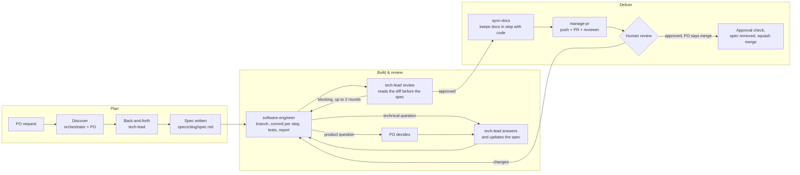

# Agentic Dev Workflow

An AI-assisted development workflow for [Claude Code](https://docs.claude.com/en/docs/claude-code/overview) that takes a change **from spec to reviewed pull request**. A human Product Owner (PO) drives each task; specialised agents plan, implement, review and deliver it, with explicit hand-offs, retry limits and escalation rules.

It is a set of plain files (agents, skills, shell scripts, templates and settings) that you drop into any repository. There is no runtime and no dependency beyond Claude Code and the usual git/GitHub tooling.

> **Language note:** this README is in English. The agent instructions, skills and internal docs (`CLAUDE.md`, `AGENTS.md`, `.claude/**`, `docs/**`, the PR template) are in **Brazilian Portuguese**, the language the workflow was originally written in. Claude follows them just as well; translate them if your team prefers.

## How it works



Every change goes through a spec; the spec's size follows the task. Each agent answers with a fixed header (`Estado:` / `Precisa de você:`), so the orchestrator knows whether a step finished, is partial, or needs the PO. A detailed view of each phase lives in [`docs/orchestration.md`](docs/orchestration.md).

## Roles

| Role | Where | What it does |
|---|---|---|
| **PO** (Product Owner) | the human | Owns the task. Approves the prompt and the spec, answers product questions, resolves escalations and is the only one who can order a merge. |
| **Orchestrator** | main conversation, [`CLAUDE.md`](CLAUDE.md) | Never implements or reviews. Runs *discover* with the PO, then relays: calls agents, forwards their answers verbatim, tracks per-task state with `state.sh` and enforces loop limits. |
| **tech-lead** | [`.claude/agents/tech-lead.md`](.claude/agents/tech-lead.md) (Opus, no Bash) | Four modes: *back-and-forth* (questions, assumptions, approach, risks), *spec* (fills the template with real file references), *question* (answers technical doubts and logs them in the spec) and *review* (reads the diff first, then compares with the spec and the recorded test output). |
| **software-engineer** | [`.claude/agents/software-engineer.md`](.claude/agents/software-engineer.md) (Sonnet, sandboxed) | Implements the spec on its own branch, one commit per step, runs the checks, saves the real output and writes a report. Never decides alone: anything outside the spec becomes a question. Idempotent: resumes from the last commit. |
| **manage-pr** | [`.claude/skills/manage-pr/`](.claude/skills/manage-pr/SKILL.md) (skill) | Delivery. Runs `sync-docs` when needed, writes the PR body from the template, opens the PR with a reviewer, and on the PO's order checks approval, removes the spec and squash-merges. All fixed steps are scripts. |

Supporting skills: [`sync-docs`](.claude/skills/sync-docs/SKILL.md) updates code-derived docs and flags human decisions instead of writing them; [`record-decision`](.claude/skills/record-decision/SKILL.md) turns an approved decision note into a dated record and updates the affected docs.

### Limits and escalation

| Loop | Limit |
|---|---|
| Review and fix | 2 rounds |
| Technical question | 2 rounds |
| Failing test | 3 attempts per test (engineer-controlled) |

Hitting a limit, or the same review finding twice, escalates to the PO. Totals are reported in every PR (`reviews · technical questions · product questions · test retries · spec-to-PR time`).

## What the tooling guarantees vs. what is only a written rule

Agent instructions are prompts, not enforcement. This workflow is explicit about which is which:

- **Guaranteed by the tooling:** the `tech-lead` has no Bash tool, and the engineer's Bash runs inside Claude Code's sandbox (`failIfUnavailable: true`).
- **Covers the usual path, but is not a barrier:** the `deny` on `git push`. Pushes only go through the `manage-pr` scripts, which refuse protected branches and never force-push. A determined agent could still find another way.
- **Known limitation:** without Bash, the `tech-lead` cannot re-run checks; it relies on the output the engineer recorded in `.work/reports/<slug>/verify.log`, and treats missing or unconvincing output as blocking.
- **Written rule only:** the `tech-lead` writing only to `specs/`; merges requiring another person's approval (`pr-check-approval.sh` checks it, but only GitHub branch protection prevents a manual merge); and the orchestrator following the steps in order.

## Repository layout

```text
.
├── CLAUDE.md                     # orchestrator rules (main conversation only)
├── AGENTS.md                     # rules every agent reads; fill in your project here
├── .claude/
│   ├── settings.json             # permissions, sandbox, no AI attribution
│   ├── workflow.conf             # base branch and protected branches
│   ├── agents/
│   │   ├── tech-lead.md
│   │   └── software-engineer.md
│   ├── skills/
│   │   ├── manage-pr/            # SKILL.md, reviewers.txt, scripts/pr-*.sh
│   │   ├── sync-docs/            # SKILL.md, scripts/docs-impact.sh
│   │   └── record-decision/
│   ├── scripts/
│   │   ├── state.sh              # per-task state in the git common dir
│   │   └── review-context.sh     # review material (diff without specs/)
│   └── templates/spec.md
├── docs/
│   ├── README.md                 # docs index (read by docs-impact.sh)
│   └── orchestration.md          # the workflow, phase by phase
└── .github/pull_request_template.md
```

At runtime the workflow also uses `specs/<slug>/spec.md` (versioned on the feature branch, removed before merge), `.work/` (reports and review material, git-ignored) and `<git-common-dir>/orchestration/state/` (task state shared by all worktrees).

## Prerequisites

- [Claude Code](https://docs.claude.com/en/docs/claude-code/overview) with sandbox support on your OS
- `git` (2.31+ for `rev-parse --path-format`)
- [`gh`](https://cli.github.com/), authenticated against the repository
- `bash` (3.2+ works, so the stock macOS shell is fine)
- A GitHub repository with an integration branch (default `dev`)

## Adapting it to your project

1. Copy `.claude/`, `CLAUDE.md`, `AGENTS.md`, `docs/`, `.github/pull_request_template.md` and the `.gitignore` entries under "Estado local do fluxo de orquestração" into your repository.
2. Edit **`.claude/workflow.conf`**: set `BASE_BRANCH` and `PROTECTED_BRANCHES`.
3. Edit **`.claude/skills/manage-pr/reviewers.txt`**: list the GitHub logins that can review PRs. `pr-open.sh` requests the first one that isn't you.
4. Fill in the sections of **`AGENTS.md`** marked `<!-- ajuste -->`: your stack, the real build/test/lint commands and your folder layout.
5. Add your project's documents to the table in **`docs/README.md`**, marking each as *Derivado* (code-derived, with the paths it covers) or *Decidido* (human decisions). `docs-impact.sh` uses those paths to decide when `sync-docs` runs.
6. Review **`.claude/settings.json`**: add allow rules for your build and test commands and adjust the sandbox paths.
7. Optionally, enable branch protection on GitHub so the "approval before merge" rule is enforced, not just checked.

Then start Claude Code at the repository root and describe the change you want: the orchestrator takes it from there.

## Roadmap

- **Coding standards:** a pluggable standards file per stack that the engineer follows and the tech-lead reviews against.
- **New skills:** e.g. a release-notes skill and a dependency-update skill that reuse the same spec → review → PR path.
- **Workflow tweaks:** a lighter path for trivial changes, better resume after interruptions, and CI results as review input.

## License

[MIT](LICENSE) © Wander Torres
