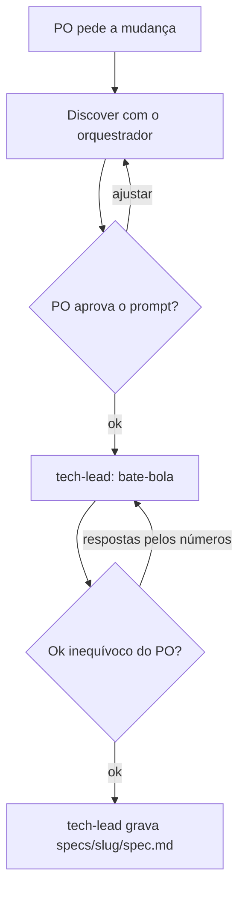
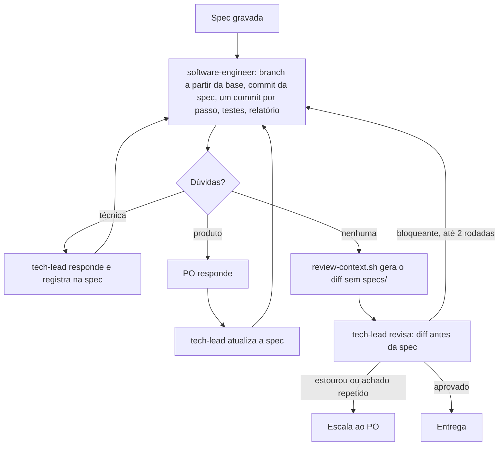
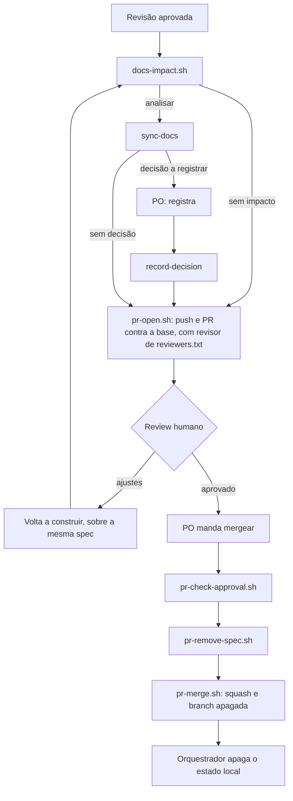

# Fluxo de orquestração

Visão para os desenvolvedores. `dev` e `main` aparecem aqui como exemplo: a branch base e as protegidas vêm de `.claude/workflow.conf`. As regras que valem para os agentes estão em `CLAUDE.md`, `.claude/agents/` e `.claude/skills/`. PO é quem conduz a tarefa e muda a cada funcionalidade.

## Planejar

## Construir e revisar

## Entregar

## Onde cada coisa fica
| Item | Local | Versionado |
|---|---|---|
| Spec | `specs/<slug>/spec.md`, na branch; sai antes do merge | Sim |
| Relatório do engenheiro | `.work/reports/<slug>/report.md` | Não |
| Saída das verificações | `.work/reports/<slug>/verify.log` | Não |
| Material da revisão | `.work/reviews/<slug>/` | Não |
| Estado | `<git-common-dir>/orchestration/state/<slug>.md`, via `.claude/scripts/state.sh` | Não |

## Modelos
A `manage-pr` declara Sonnet e roda na conversa principal, então troca o modelo dela enquanto atua. A documentação diz que a troca vale até a próxima mensagem do PO, mas um teste viu a conversa continuar em Sonnet: confira o modelo se o orquestrador estiver em outro.

## O que é garantido e o que é só regra escrita
- **Garantido pela ferramenta:** o `tech-lead` não tem Bash, e o sandbox limita o Bash do engenheiro.
- **Cobre a forma usual, sem ser barreira:** o deny de `git push`. Push só passa pelos scripts da `manage-pr`, que recusam as branches protegidas.
- **Limite conhecido:** sem Bash, o `tech-lead` não reexecuta as verificações; ele depende da saída gravada pelo engenheiro.
- **Só regra escrita:** o `tech-lead` escrever só em `specs/`, o merge exigir aprovação (o `pr-check-approval.sh` confere, mas só a proteção de branch do GitHub impede um merge manual, e ela não está disponível em todo plano) e o orquestrador seguir a ordem dos passos.
